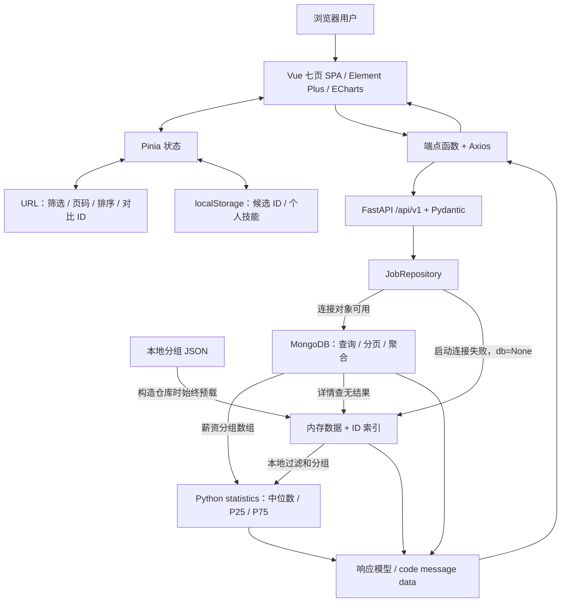

# JobInsight 项目现状与 MongoDB 选型审查

- 报告时间：2026-10-20 20:36:14，Asia/Shanghai（UTC+08:00）。
- 审查基线：Git `461044d3e79e6eb291b82c529134c34c5522e47a`，提交时间 2026-10-20 20:05:34 +08:00；另检查本机被 Git 忽略的数据文件。本次文档整理不代表业务代码变更。
- 审查方法：静态阅读源码、依赖清单与锁文件，使用标准库只读重算本地数据；外部能力沿用本任务已核实的官方资料，访问日期为 2026-10-20。
- 验证边界：没有启动前后端、连接数据库、执行应用测试、性能对照或浏览器验收，也没有运行采集、清洗、灌库脚本。下文“已实现”指源码具备相应逻辑，不能自动理解为本次运行验收通过。
- 配套交付：[文档时效与归档清单](2026-10-20_203614_documentation-audit.md)。当前契约入口：[字段字典](../data-dictionary.md)、[岗位分类](../job-classification.md)、[统计口径](../statistical-methodology.md)、[数据准备状态](../data-preparation-checklist.md)。

## 1. 先回答：MongoDB 是不是为了用而用？

**MongoDB 已经承担真实查询和聚合职责，但当前需求与数据尚未证明必须使用 MongoDB，也没有证据证明它比 MySQL、SQLite 或现有 JSON 路径更快。**

如果“为了用而用”指“只把文件塞进数据库、业务没有实际使用”，这个判断不符合代码：岗位检索、分页、详情、概况、薪资分组和技能统计都有 MongoDB 实现。如果指“先选定技术，再为它寻找不可替代的理由”，这个疑问有依据：现有负载只是约 4.19 MB 的单来源、统一字段、只读样本，应用还保留了可以完成当前查询的 JSON/Python 路径。仅凭数据含有技能数组、系统名称包含“大数据”，无法推出 MongoDB 的技术必要性。

历史 NoSQL 复评把“必须使用 NoSQL”记录为项目约束；如果该约束仍成立，MongoDB 可以诚实地作为课程或项目技术要求下的文档数据库选型，展示文档建模、嵌套查询与聚合。**项目约束与性能优势是两种理由，不能互相替代。** 历史结论也明确没有证明 MongoDB 胜过 MySQL，且没有批准为选型论证追加服务器收藏或复杂版本系统。依据：[历史 PRD](../../.trellis/tasks/archive/2026-10/10-20-nosql-data-layer-review/prd.md)第 12—15 行、[归档结论](../../.trellis/tasks/archive/2026-10/10-20-nosql-data-layer-review/closure.md)第 5—12 行。

本报告建议保留现有应用功能，如实说明 MongoDB 的使用位置和选择条件；本轮不迁移数据库、不增设服务，也不把已关闭研究中的候选改造当作待办。

## 2. 现在实现了什么

项目当前是一个基于既有招聘样本的分析与选岗辅助系统。前端已有 **7 个业务页面**，并非旧交接材料中的 4 页；后端提供 **7 个业务 GET 路径**。页面通过 API 获取岗位事实与统计，候选清单和个人技能则保存在本浏览器。

### 2.1 七个页面与功能边界

| 页面 / 路由 | 源码中已有的主要功能 | 数据和状态由谁负责 | 需要准确说明的边界 |
| --- | --- | --- | --- |
| 求职工作台 `/workbench` | 类别、省份、学历快捷探索；显示候选/对比数量；设置个人技能；进入分析页 | API 提供条件与技能候选，Pinia / 浏览器保存个人状态 | 候选和对比数量是用户选择计数，不能当作招聘市场指标。见 [WorkbenchView.vue](../../frontend/src/views/WorkbenchView.vue)第 36、46、59、71 行。 |
| 岗位探索 `/jobs` | 类别、省份、学历、关键词、月薪范围、有无技能标签；条件标签移除/清空；排序；10/20/50/100 条分页；详情、收藏、对比 | 后端检索与分页；已应用条件写入 URL，控件保留提交前草稿 | 关键词为综合文本检索；技能页跳来的标签仍是关键词搜索，不是独立精确技能筛选。见 [JobsView.vue](../../frontend/src/views/JobsView.vue)第 28、86、137、179、213 行及 [jobQuery.ts](../../frontend/src/utils/jobQuery.ts)第 4、66、114 行。 |
| 候选清单 `/shortlist` | 收藏 ID 按最近加入排序；每页 10 条；逐条加载详情；移除、对比、失败重试 | 收藏 ID 来自 localStorage，详情来自现有详情 API | 没有服务器收藏表或跨设备同步。404 保留选择，仅说明当前数据未找到，不能认定职位已下架。见 [ShortlistView.vue](../../frontend/src/views/ShortlistView.vue)第 11、22、40、122 行。 |
| 岗位对比 `/compare` | 最多 3 岗并排比较薪资、地点、学历、经验、专业、技能等事实；添加/替换/移除；逐项重试；个人技能标签核对 | 复用详情 API；对比 ID 在 Pinia，并写入 URL 供刷新恢复/分享 | 技能核对是集合交集和差集，没有能力评分、推荐排名或录用概率。见 [CompareView.vue](../../frontend/src/views/CompareView.vue)第 36、78、113、164、224 行及 [skillCheck.ts](../../frontend/src/utils/skillCheck.ts)第 16—35 行。 |
| 样本概况 `/overview` | 岗位总量、有效薪资数、技能标注数、重复合并组数、薪资中点中位数、类别构成图；带全局条件跳转 | 后端统计，前端图表展示 | 重复合并不等于多招聘平台；当前来源主机只有一个。见 [OverviewView.vue](../../frontend/src/views/OverviewView.vue)第 34、49、135、166 行。 |
| 薪资与地域 `/salary` | 类别/省份薪资统计；中位数、P25/P75、样本量、低样本和排名；图表及透视表 | 两个统计 API 并行请求；后端计算统计值 | 有效薪资样本少于 5 的桶不进入排名；中点是招聘区间估计，不能当作实际到手收入。见 [SalaryView.vue](../../frontend/src/views/SalaryView.vue)第 32、55、155、302、377 行。 |
| 技能标签 `/skills` | Top 20 双系列柱图、前 8 项雷达图、频次/双分母比例/标注覆盖率；跳转搜索 | 后端计算 K、L、N；ECharts 展示 | 未标注不等于不需要技能；比例不能推导学习某技能会涨薪。见 [SkillsView.vue](../../frontend/src/views/SkillsView.vue)第 39、60、155、239、253 行。 |

路由与懒加载证据见 [router/index.ts](../../frontend/src/router/index.ts)第 4—58 行。共用[详情抽屉](../../frontend/src/components/JobDetailDrawer.vue)第 49、131、206、247、299 行展示岗位原文、薪资排除原因、技能证据、来源 ID 和招聘链接；打开原链接不表示本次已核实招聘有效期。

### 2.2 七个业务 GET API

统一前缀为 `/api/v1`，成功响应使用 `{ code: 200, message: "success", data: ... }`。

| 完整路径 | 职责 | 条件 / 边界 |
| --- | --- | --- |
| `GET /api/v1/meta/options` | 类别、省份、学历筛选项 | 元数据读取 |
| `GET /api/v1/overview` | 概况计数、薪资中点中位数、类别分布、技能覆盖 | 转发类别、省份、学历 |
| `GET /api/v1/stats/salary-by-category` | 按类别计算薪资统计和排名标记 | 转发类别、省份、学历 |
| `GET /api/v1/stats/salary-by-region` | 按省份计算薪资统计和排名标记 | 转发类别、省份、学历 |
| `GET /api/v1/stats/skills-top` | 技能频次、K/L、K/N、L/N | 三个全局条件及 `limit`，范围 1—100 |
| `GET /api/v1/jobs` | 岗位列表、总数、排序和分页 | 另有关键词、薪资上下界、有无技能；页大小上限 100；排序字段有白名单 |
| `GET /api/v1/jobs/{job_id}` | 代表 ID 或成员来源 ID 对应的详情 | 不存在时 HTTP 404；连接 MongoDB 时查无结果仍可能命中本地 JSON |

依据：[路由聚合](../../backend/app/api/v1/api.py)第 10—13 行、[meta](../../backend/app/api/v1/endpoints/meta.py)第 13 行、[overview](../../backend/app/api/v1/endpoints/overview.py)第 15—25 行、[stats](../../backend/app/api/v1/endpoints/stats.py)第 18—58 行、[jobs](../../backend/app/api/v1/endpoints/jobs.py)第 14—61 行、[响应模型](../../backend/app/schemas/response.py)。另有 `/health` 和 FastAPI 生成的 API 文档；它们不计入业务接口数。

**列表的全部条件不会自动影响所有统计图。** 当前分析端点只向仓库转发类别、省份、学历，列表另外接受关键词、薪资和标签条件。因此“所有列表结果与所有图表始终是同一筛选集合”不是当前实现事实。

未发现账号登录、服务端收藏、投递跟踪、简历解析、在线智能推荐、招聘有效状态验证或数据导出实现。个人技能只对照已有标签，不评估熟练度；离线分类中名字含 AI 的类也不能作为接入大模型的证据。

## 3. 实现技术栈与版本证据

版本需区分三层：`package.json` / `requirements.txt` 是声明；锁文件是解析记录；本机运行时是本次观察值。锁定版本不等于本次已核实的安装版本，也不等于外部最新版本。

### 3.1 前端

| 技术 | manifest 声明 | package-lock 解析版本 | 实际用途 |
| --- | --- | --- | --- |
| Vue | `^3.5.42` | `3.5.44` | 组件与 Composition API |
| Vue Router | `^5.4.0` | `5.4.0` | 7 页 SPA 路由、URL 查询状态 |
| Pinia | `^4.1.0` | `4.1.0` | 全局筛选、候选/技能/对比状态 |
| Element Plus | `^2.14.7` | `2.14.7` | 表格、表单、抽屉、反馈组件 |
| ECharts | `^6.1.0` | `6.1.0` | 概况、薪资、技能可视化 |
| Axios | `^1.20.0` | `1.20.0` | `/api/v1` HTTP 请求与统一错误处理 |
| TypeScript | `~6.0.2` | `6.0.3` | 前端类型检查 |
| Vite | `^8.3.0` | `8.3.4` | 开发服务器、API 代理、生产构建 |
| Vitest | `^5.0.5` | `5.0.5` | 工具函数与状态行为单测定义 |
| vue-tsc | `^3.3.11` | `3.3.13` | Vue / TypeScript 构建前类型检查 |

其他锁定记录包括 `@vitejs/plugin-vue 6.0.10`、`@vue/tsconfig 0.9.1`、`@element-plus/icons-vue 2.3.2`、`@types/node 24.19.2`。证据：[package.json](../../frontend/package.json)第 6—29 行、[package-lock.json](../../frontend/package-lock.json)，结构化摘录见同目录的[只读审计记录](2026-10-20_203614_data-stack-evidence.json)。

前端 `build` 先运行 `vue-tsc -b`，再 `vite build`；测试命令为 `vitest run`。本机观察到 Node `v22.22.3`。锁文件中的 Vite 要求 Node `^20.19.0 || >=22.12.0`，旧文档的 Node 18+ 不足以覆盖该要求；本报告不把 Node 的本机版本当作部署规范，也不推断依赖已经安装并通过构建。

### 3.2 后端、存储与工程工具

| 技术 | 仓库声明 / 观察 | 用途与审查结论 |
| --- | --- | --- |
| Python | README 采用 3.11+，Ruff 目标 `py311`；本机观察 `3.11.9` | FastAPI 服务与离线处理语言；`backend/uv.lock` 头部却声明 `>=3.13`，存在配置一致性问题 |
| FastAPI / Uvicorn | `fastapi>=0.110.0`、`uvicorn[standard]>=0.28.0` | 异步 HTTP API / ASGI 服务 |
| Pydantic / Settings | `pydantic>=2.6.4`、`pydantic-settings>=2.2.1` | 响应与查询类型、环境配置 |
| Motor / PyMongo | `motor>=3.3.2`、`pymongo>=4.6.2` | MongoDB 异步连接和数据库相关工具；当前仓库没有可用的后端解析版本锁 |
| MongoDB | Compose 声明 `mongo:7.0` | 单个数据库服务，端口 27017、命名卷持久化；镜像声明不等于已经启动或当前服务器版本已验证 |
| JSON / Python 标准库 | 本地 `jobs_cleaned_grouped.json`、`statistics` | 备用数据读取、过滤与统计；MongoDB 路径的精确分位数也回到 Python 计算 |
| HTTPX / PyYAML | `httpx>=0.27.0`、`pyyaml>=6.0.1` | 仓库声明的请求/配置工具；依赖存在不能证明接入外部模型或实时采集 |
| pytest / pytest-asyncio / Ruff | `>=8.1.1` / `>=0.23.6` / `>=0.3.0` | 已有测试与静态检查工具，本次未执行应用检查 |
| Docker Compose | 根目录 Compose 仅定义 MongoDB | 不构成前后端完整容器部署；未声明副本集或分片 |

证据：[requirements.txt](../../backend/requirements.txt)第 1—11 行、[uv.lock](../../backend/uv.lock)第 1—3 行、[pyproject.toml](../../backend/pyproject.toml)、[配置](../../backend/app/core/config.py)第 6 行、[docker-compose.yml](../../docker-compose.yml)第 1—14 行。

后端 requirements 使用的是 `>=` 下限，不能称为“固定依赖版本”。当前 `uv.lock` 只有格式、修订及 Python 要求，没有解析后的包条目，不能用它报告 FastAPI、Motor 等实际锁定版本。

## 4. 当前架构与数据流

### 4.1 架构图



图中的 MongoDB 与 JSON 是两条已存在的读取路径；没有绘制未实现的采集服务、同步服务、账户数据库或分布式计算平台。当前 API 不负责将 JSON 自动发布到 MongoDB，因此两者一致性也不能靠“有回退”来保证。

### 4.2 一次请求经过哪里

1. **服务启动与数据源选择**：FastAPI lifespan 尝试连接并 ping MongoDB；初始连接失败则设置 `db=None`。这支持启动时使用本地数据，不能推断已建立连接后的每次查询异常都能透明切换。`/health` 只返回应用状态，不会证明当前正在使用 MongoDB。依据：[main.py](../../backend/app/main.py)第 29 行、[mongodb.py](../../backend/app/db/mongodb.py)第 15 行。
2. **仓库预载本地数据**：`JobRepository` 构造时始终加载本地 JSON 和 ID 索引，包括随后可正常使用 MongoDB 的情况。所以数据库模式仍有本地样本内存成本；缺少数据文件不能简单理解为 MongoDB 会自动补齐。依据：[repository.py](../../backend/app/db/repository.py)第 160—198 行。
3. **前端发起请求**：页面或详情组件调用 API 函数，Axios 使用 `/api/v1` 和 15 秒超时；拦截器检查业务码并统一处理错误，**返回的仍是完整 Axios response**，各端点函数读取 `res.data.data`。依据：[client.ts](../../frontend/src/api/client.ts)第 12—29 行、[jobs.ts](../../frontend/src/api/jobs.ts)第 6—20 行。
4. **API 校验与转发**：FastAPI/Pydantic 校验查询参数，端点向仓库传递本接口支持的条件。列表支持的条件多于分析端点；响应经 schema 投影后包装返回。
5. **MongoDB 读取路径**：概况使用 `$facet`；类别/省份薪资使用分组聚合；技能统计使用 `$facet`、`$unwind`、`$group`；列表使用 `count_documents` 与 `find().sort().skip().limit()`；详情按代表 ID 或成员来源 ID 查找。依据：[repository.py](../../backend/app/db/repository.py)第 294、375、438、501、585、615 行。
6. **统计不全在数据库内完成**：MongoDB 先生成薪资中点数组，Python 再用 `statistics.median` 与 inclusive 四分位数计算 P25/P75。JSON 路径在 Python 内完成过滤、分组和统计。依据：[repository.py](../../backend/app/db/repository.py)第 91—105、408—429、484—492 行。
7. **详情存在额外回落**：即使 MongoDB 连接可用，若详情查询返回空，`get_job_by_id` 仍会查本地 `_id_index`。因此一次详情成功并不必然证明该岗位存在于当前 MongoDB 集合；也不能把这种查无结果回落推广成所有接口的运行期故障转移。依据：[repository.py](../../backend/app/db/repository.py)第 955 行附近。
8. **浏览器展示与持久化**：统计数值由 API 返回，`useECharts` 负责挂载、resize、清理与 dispose。个人候选 ID 和技能写入 `jobinsight:workspace:v1`；对比 ID 保存在 Pinia 与 URL，最多 3 项，不进入该 localStorage 载荷。依据：[useECharts.ts](../../frontend/src/composables/useECharts.ts)第 5、41、45、56 行、[workspace.ts 工具](../../frontend/src/utils/workspace.ts)第 3、80、105、116 行、[workspace store](../../frontend/src/stores/workspace.ts)第 18—30、78—98 行。

用户技能为 `null` 表示未设置，`[]` 表示明确没有选择；岗位无技能标签时不能核对。换设备不会同步候选/技能；分享对比 URL 只分享岗位 ID，不包含个人技能或收藏。全局类别/省份/学历仅用于探索和三张分析页，进入工作台、候选或对比会重置切片。依据：[skillCheck.ts](../../frontend/src/utils/skillCheck.ts)第 20、31 行、[router/index.ts](../../frontend/src/router/index.ts)第 62 行。

### 4.3 部署到什么程度

仓库提供的是分开运行的开发组合：Vite 5173 端口经 `/api` 代理到后端 8000，Compose 提供 MongoDB 27017。生产构建输出静态资源并拆分部分 vendor 块，但仓库没有同时编排前后端的生产服务，也没有据此验证反向代理或 SPA history 回退。README 中的 Nginx 是部署建议，不能写成已配置上线。依据：[vite.config.ts](../../frontend/vite.config.ts)第 12—29 行、[docker-compose.yml](../../docker-compose.yml)、[README](../../README.md)。

## 5. 数据究竟有多大、可以说明什么

以下数字来自本次研究阶段的只读审计，记录时间为 2026-10-20 20:21:52 +08:00。输入为本机 `data/processed/jobs_cleaned_grouped.json`，4,189,728 字节，SHA-256：

```text
0f317fb486052a56f1c1f00b6c00da071c12f9fec98dd7993273469eb13498b1
```

| 项目 | 当前值 | 正确解释 |
| --- | --- | --- |
| 分组后的岗位样本 | 2,251 组 | 按来源 19 列原始字符串精确分组；不是经外部确认的独立招聘需求数 |
| 来源 ID | 3,000 个，均唯一 | 305 个组含多个来源记录；详情可用代表或成员 ID 查询 |
| 来源及结构 | 1 个来源主机 `job.ncss.cn`；1 种顶层字段形状，共 29 字段 | 未证明多平台接入、持续变更 schema 或历史版本负载 |
| 薪资有效样本 | 2,194 组 | 有可统计闭区间；全量中点中位数 12,000 元/月，是样本区间估计 |
| 技能标注 | 833 组，覆盖约 37.01% | 其余样本缺标签，不代表不需要技能 |
| 技能词与条目 | 24 个名称，2,287 个组级技能条目 | 来自当前有限标注，不是完整行业词库 |
| 分类 | 1,848 组规则分类，403 组未分类 | 不等同于人工确认分类 |
| 离线复核 | 3,000 行全部 `pending` | 尚不能宣称人工复核或独立模型验收完成 |
| 发布日期范围 | 2025-10-21 至 2026-10-16 | 日期跨度不证明连续采集、历史版本跟踪或岗位当前有效 |

证据：[结构化只读审计](2026-10-20_203614_data-stack-evidence.json)；来源、分组及统计解释对应[字段字典](../data-dictionary.md)、[分类契约](../job-classification.md)和[统计口径](../statistical-methodology.md)。数字用于说明本次快照，不应硬编码成未来 API 运行常量。

技能比例必须随筛选集合重算：N 为当前全部岗位组，L 为其中有技能标签的组，K 为带某技能的组。API 分别返回 **K/L（已标注样本内部比例）**、**K/N（全部样本中的标注比例）** 和 **L/N（标注覆盖率）**。全量快照的 L=833、N=2,251，切片后不能继续固定使用这两个数字。小于 5 的有效薪资桶不参与薪资排名；5 也只是展示门槛，不保证统计显著。依据：[统计口径](../statistical-methodology.md)、[repository.py](../../backend/app/db/repository.py)第 408—429、501—581 行。

现有证据支持称为“招聘样本分析系统”。没有证明海量数据处理、分布式存储计算、流式采集、实时市场覆盖、因果薪资分析或全国招聘市场代表性。

## 6. MongoDB 的真实价值、代价与替代性

### 6.1 三个问题分开判断

| 问题 | 本次判断 | 证据与限制 |
| --- | --- | --- |
| 是否真正用到了 MongoDB？ | 是，源码已有业务读取与原生聚合 | 不是仅把 JSON 存进去；但本次未连接服务器验证实际请求走向 |
| 当前业务是否非 MongoDB 不可？ | 未证明 | 固定字段、单来源、小型只读快照；已有 JSON/Python 功能路径；关系模型也能表达岗位、来源、技能与证据 |
| 是否证明 MongoDB 比 MySQL 更快？ | 没有 | 无同数据、同语义、同硬件的对照；无本次执行计划、延迟、吞吐、内存或并发结果 |

### 6.2 已有适配点

一份岗位文档可以同时包含稳定字段、`source_ids`、技能及来源/证据对，读取详情时组织直接；代码已经把过滤、分页和一部分聚合放在 MongoDB。这些是当前可讲清楚的实现价值。技能统计展开的是组级唯一技能名称，岗位样本计数与技能条目计数分开处理，避免把一岗多技能放大成多条岗位。

MongoDB 官方文档说明聚合管道可优化，适当索引可减少工作，但实际使用情况需要执行计划判断。因此本项目只能报告“实现了这些查询”，不能报告“所有查询命中索引”“高并发已验证”或“性能胜出”。参考：[MongoDB 聚合管道优化](https://www.mongodb.com/docs/manual/core/aggregation-pipeline-optimization/)（访问：2026-10-20；手册可能描述较新服务器，仓库部署声明仍为 7.0）。

### 6.3 当前付出的成本与未成立的理由

- **多一套服务和交付依赖**：要管理 MongoDB、数据导入、连接和集合状态；本地数据及 seed 未进入 Git，干净克隆的可运行性有缺口。
- **两条实现需要维持语义一致**：MongoDB 与 Python 路径分别实现过滤和统计，详情还可能跨源回落。不能因为都能返回数据，就认为样本版本、空值、排序和统计口径已经一致。
- **仍预载全部本地样本**：MongoDB 可用时也加载 JSON；当前设计没有因此消除本地全量数据内存开销。
- **薪资分位数仍传回 Python**：不能宣称全部统计均在数据库原生完成；这是否构成性能问题需要量测，当前 2,251 组不足以自行证明问题或优势。
- **索引声明不是命中证据**：本机忽略的 seed 文件声明 4 个索引，其中 2 个复合、2 个单字段；这不证明当前数据库已创建，也不证明查询实际使用。脚本已按历史约束弃用，本轮不运行或恢复它。依据：[seed.py](../../backend/app/db/seed.py)第 77 行附近、[历史约束](../../.trellis/tasks/archive/2026-10/10-20-nosql-data-layer-review/prd.md)第 14 行。
- **“嵌套数据只能用 MongoDB”不成立**：关系模型可将岗位、技能、来源及证据拆表；MySQL 也支持 JSON。多来源、频繁字段变化、历史版本和服务端个人工作区均不是当前已证实的业务负载，不能用未来假设替当前选型背书。

### 6.4 与可替代方案的公平比较

| 方案 | 对当前需求能承担什么 | 需要承担的成本 / 不能直接下的结论 |
| --- | --- | --- |
| 现有 MongoDB | 文档详情、嵌套条件、数据库分页、聚合；已存在实现 | 额外数据库服务、导入与双路径一致性；尚无性能优势实测 |
| MySQL 关系模型 | 岗位、来源 ID、技能、证据可拆为关联表；实现筛选、分页和统计 | 需要明确关联与去重，防止技能连接放大岗位计数；未实现迁移，不能称其已更快或更省维护 |
| MySQL 关系字段 + JSON | 常查字段保留普通列，来源/证据等可选嵌套内容使用 JSON | 原生 JSON、相关函数及索引机制已存在，但查询设计仍需验证；“不用 MongoDB 就不能存嵌套内容”不成立 |
| SQLite | 单应用或本地演示可用 SQL 管理当前小型快照，减少独立数据库服务 | 这是针对当前负载的工程推断；多实例、网络部署和并发写需求会改变取舍，本次未做实现或量测 |
| 现有 JSON / Python | 已有当前接口的本地读取与统计实现，说明当前快照存在功能替代路径 | 全量预载、Python 过滤/排序及多进程内存等需要按目标负载评估；功能可替代不等于生产并发性能相同 |

外部能力依据：[MySQL 8.4 JSON 类型](https://dev.mysql.com/doc/refman/8.4/en/json.html)、[SQLite 适用场景](https://www.sqlite.org/whentouse.html)（均访问于 2026-10-20）。MySQL 官方文档包括 JSON 函数、生成列索引和 InnoDB 多值索引能力；SQLite 对单应用、本地数据和分析有明确适用说明。这里仅用来排除“只有 MongoDB 能做”的论证，不据此推导任何方案已在本项目中胜出。

**选型建议**：NoSQL 若仍是明确项目约束，就保留 MongoDB 并按当前真实实现汇报；若只追求小型静态演示的功能与低维护成本，JSON 或 SQLite 值得在另行明确需求后比较。当前既无必要为维护 MongoDB 论证而追加功能，也没有足够证据要求立刻迁移。

## 7. 当前缺口与文档不能掩盖的问题

| 事项 | 当前证据 / 影响 | 本轮处理边界 |
| --- | --- | --- |
| 数据与启动可复现性 | `.gitignore` 忽略处理后的 JSON/CSV 和 `backend/app/db/seed.py`；来源 CSV 位于仓库外历史工作区。本机存在不代表干净克隆具备。 | 披露输入边界，更新文档说明；不执行弃用脚本补齐数据。见 [.gitignore](../../.gitignore)第 56—61 行。 |
| 数据库运行与性能证据 | 没有本次 MongoDB 连接、实际集合/索引检查、`explain`、压测或数据库对照；健康接口不报告活跃数据源。 | 不把代码路径、索引定义或详情成功当成数据库验收。 |
| 分类尚未人工确认 | 3,000 行复核均 pending；`AIJobClassifier` 的第二通道实际是正则/关键词，没有看到 LLM API 调用。 | 明确“规则分类”和“人工/独立模型确认”的区别。见 [ai_classifier.py](../../temp/data_prep/ai_classifier.py)第 121、142—151、194、408、428 行。 |
| 技能与薪资样本有限 | 技能覆盖约 37.01%；少量类别/地区样本不足；来源薪资疑点没有本次原网页核实。 | 保留覆盖率、低样本及非因果解释；不把缺标签填成无需求。 |
| 来源类型与 API schema 差异 | 来源契约允许企业、技能证据为空及十进制薪资；API 中部分字段是非空字符串或整数。 | 报告差异，不宣称 21 列来源定义与 API 模型完全等同，也不在缺乏运行证据时断言当前样本已报错。见 [job.py](../../backend/app/schemas/job.py)第 5—7、21、28—29 行与[字段字典](../data-dictionary.md)。 |
| 统计/排序契约差异 | 分析只用 3 个全局条件；Mongo 列表单字段排序未显式加契约要求的 ID 二级键；内存路径也未显式构造该键。 | 保留规范目标并披露实现边界，不改代码迎合本次审查。见 [repository.py](../../backend/app/db/repository.py)第 600—601、933—945 行。 |
| 部分健壮性边界 | 清洗薪资逻辑未见显式 `isfinite`；三张分析页失败主要依赖 toast/console，可能保留旧数据，且未见防旧响应覆盖的 token；部分技能 KPI 在未成功获取时默认 0。 | 这是源码观察，未做 UI 复现；不能统称“全部异常/并发情况已完善”。见 [clean_and_group.py](../../temp/data_prep/clean_and_group.py)第 265—270 行、[OverviewView.vue](../../frontend/src/views/OverviewView.vue)第 34 行、[SalaryView.vue](../../frontend/src/views/SalaryView.vue)第 32 行、[SkillsView.vue](../../frontend/src/views/SkillsView.vue)第 39、270、281 行。 |
| 依赖与环境一致性 | 后端没有有效版本锁，Python 要求存在 3.11/3.13 差异；旧 Node 18+ 文案不符 Vite 锁文件要求。 | 说明声明、锁定与本机运行时差别；不把文案修正说成依赖兼容性已验证。 |
| 驱动维护 | 官方已提供 Motor 到 PyMongo Async 的迁移指导。 | 记录维护观察，不在本任务迁移，也不拼接未核对的生命周期日期。参考：[官方迁移指南](https://www.mongodb.com/docs/languages/python/pymongo-driver/current/reference/migration/)（访问：2026-10-20）。 |

以上是现状审查发现，不是已获批准的业务改造清单。文档整理保留有效字段、分类与统计契约，原文快照及逐项时效判断见[归档清单](2026-10-20_203614_documentation-audit.md)。

## 8. 已有什么检查，哪些没有验证

仓库静态检查发现后端 `test_api.py` 中 12 个测试函数定义、`test_mongo_aggregation.py` 中 8 个测试函数定义；Mongo 测试夹具在服务不可用时会跳过。前端 3 个测试文件共有 42 个 `it` 定义，覆盖查询参数、对比 ID、工作区持久化及不评分的技能集合核对。**这些数字是测试定义数，不是本次通过数。**

依据：[test_api.py](../../backend/tests/test_api.py)、[test_mongo_aggregation.py](../../backend/tests/test_mongo_aggregation.py)、[job-query.spec.ts](../../frontend/src/utils/__tests__/job-query.spec.ts)、[compare-ids.spec.ts](../../frontend/src/utils/__tests__/compare-ids.spec.ts)、[workspace-utils.spec.ts](../../frontend/src/utils/__tests__/workspace-utils.spec.ts)。未发现可据以宣称整体 UI 已验收的组件/E2E 测试，本次也未新增或运行应用测试。

本次审查的直接证据是源码/配置阅读、只读数据计数与哈希、依赖记录和文档一致性核对。原文快照哈希、路径映射、文档链接及范围检查结果由配套[文档审查清单](2026-10-20_203614_documentation-audit.md)和任务验证记录承载；历史“已通过”记录保留为历史证据，不转述成本次复测。

适合对外汇报的表述是：**Vue + TypeScript 实现七页分析与选岗界面，FastAPI 提供七个只读业务 API，MongoDB 承担实际检索与部分聚合，本地 JSON/Python 提供既有样本读取路径；统计基于 2,251 组固定样本，候选与个人技能保存在浏览器。MongoDB 的组织与查询价值已在代码中体现，其不可替代性和性能优势尚未证明。**
